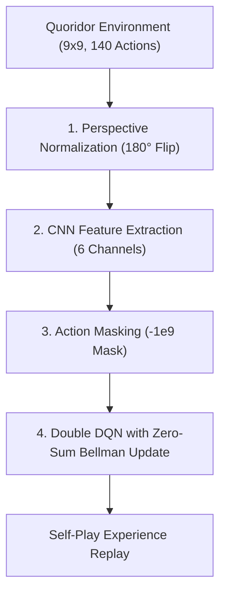

# ♟️ Quoridor AI: CNN Double DQN with Perspective Normalization

[](https://www.python.org/)
[](https://pytorch.org/)
[](https://opensource.org/licenses/MIT)
[-brightgreen.svg)]()
[](https://colab.research.google.com/)

> **Quoridor(쿼리도)** 보드게임의 $10^{20}$ 이상에 달하는 거대한 상태 공간을 정복하기 위해 설계된 심층 강화학습(Deep Reinforcement Learning) AI 프로젝트입니다.  
> 단계적 확장 로드맵(**Rule Engine → Baseline Bots → Tabular Q → Linear Q → CNN Double DQN**)을 거쳐 풀 사이즈(9×9, 벽 10개) 환경에서 베이스라인 봇들을 상대로 압도적인 승률을 달성했습니다.

---

## 🏆 Arena Benchmark Results (최종 아레나 성능)

풀 사이즈 9×9 보드에서 500 에피소드 자기 주도 셀프 플레이(Self-Play) 학습을 거친 최종 DQN 에이전트의 대결 결과:

| 대국 상대 (Opponent) | 승리 / 대국수 | 최종 승률 (Win Rate) | 플레이 스타일 요약 |
| :--- | :---: | :---: | :--- |
| **RandomBot** | **48 / 50** | **96.0%** | 모든 합법 이동 및 벽 설치를 무작위로 수행 |
| **ShortestPathBot** | **50 / 50** | **100.0% (전승!)** | BFS 기반 항상 최단 경로로만 직진하는 탐욕 알고리즘 |

---

## 🧠 4대 핵심 이론 및 설계 원칙 (Core Principles)



### 1. 관점 정규화 (Perspective Normalization) & 대칭 액션 변환
- **문제점**: 2인 제로섬 게임에서 P0는 아래에서 위로(North), P1은 위에서 아래로(South) 전진합니다. 상태판만 180도 회전시키면 신경망의 전진 의도(North, Action 0)와 실제 게임판의 전진(South, Action 1)이 충돌하여 상충된 그래디언트가 발생합니다.
- **해결책**:
  - `encode_state()`: P1 턴일 때 좌표계를 180도 회전시켜 신경망 입력 텐서를 항상 "내 말이 아래쪽, 목표선이 위쪽"으로 일치시킵니다.
  - `flip_action()`: P1 턴일 때 합법 액션 마스크와 출력 액션을 180도 대칭 변환하는 자체 역함수(Involution)를 적용하여 P0/P1 간 완벽한 정책 대칭성을 확립했습니다.

### 2. 제로섬 벨만 업데이트 (Zero-sum Bellman Equation)
- 턴이 넘어갈 때마다 상대방의 이득은 곧 나의 손실이 됩니다.
- 일반적인 DQN 타깃과 달리 다음 상태 가치에 **마이너스 부호**를 부여하여 적대적 가치 업데이트를 수행합니다:
$$\text{Target} = R - (1 - \text{done}) \cdot \gamma \cdot Q_{\text{target}}(s', \arg\max_{a'} Q_{\text{policy}}(s', a'))$$

### 3. 액션 마스킹 (Action Masking)
- 140차원의 행동 공간(이동 12개 + 벽 설치 128개) 중 보드 경계, 벽 충돌, 경로 봉쇄(BFS) 규칙에 의해 매 턴 대다수의 행동이 불법(Illegal)으로 판정됩니다.
- 신경망 출력 로짓에서 불법 행동의 가치를 $-\infty$ ($-10^9$)로 마스킹하여 역전파 시 유효한 합법 수에만 소프트맥스/아그맥스 그래디언트가 흐르도록 최적화했습니다.

### 4. Double DQN & 그래디언트 클리핑
- 가치 과대평가(Overestimation Bias)를 억제하기 위해 **Policy Net(행동 선택)**과 **Target Net(가치 평가)**을 분리했습니다.
- Smooth L1 Loss(Huber Loss)와 파라미터 노름 클리핑(`max_norm=1.0`)을 적용하여 보상이 희소한 체스/보드게임 환경에서도 가중치 폭발 없이 안정적인 수렴을 달성했습니다.

---

## 📂 프로젝트 구조 (Repository Architecture)

```
quoridor_project/
├── quoridor/                    # 핵심 AI 및 게임 엔진 패키지
│   ├── __init__.py              # 패키지 익스포트
│   ├── env.py                   # 9x9 Quoridor 규칙 엔진, 벽 충돌 판정, BFS 봉쇄 검사
│   ├── model.py                 # CNN 기반 QuoridorDQN 신경망 아키텍처
│   ├── buffer.py                # ReplayBuffer & Double DQN 제로섬 손실 계산
│   └── agent.py                 # Agent, RandomBot, ShortestPathBot, GreedyWallBot, DQNAgent
├── tests/                       # 단위 테스트 스위트 (100% Pass)
│   ├── test_env.py              # 이동, 점프(직선/대각), 승리 조건, 렌더링 검증
│   └── test_walls.py            # 벽 교차, 겹침, 경로 차단 BFS 검증
├── guides/                      # 단계별 심층 튜토리얼 노트북 (Phase 0 ~ Phase 4)
├── checkpoints/                 # 학습된 모델 체크포인트
├── quoridor_workspace.ipynb     # 전체 개발 및 학습 파이프라인 단일 통합 워크스페이스
├── .gitignore                   # 불필요한 캐시 및 대용량 파일 제외 설정
└── README.md                    # 프로젝트 문서
```

---

## 🗺️ 단계별 점진적 확장 로드맵 (Roadmap)

| Phase | 단계명 | 핵심 내용 및 성과 | 상태 |
| :---: | :--- | :--- | :---: |
| **Phase 0** | **환경 및 규칙 엔진** | 140차원 액션 공간 정의, 점프 엣지 케이스, BFS 기반 벽 경로 봉쇄 검사 최적화 (pytest 36개 100% 통과) | ✅ |
| **Phase 1** | **베이스라인 에이전트** | `RandomBot`, BFS 최단 경로 직진 봇 `ShortestPathBot`, 휴리스틱 방해꾼 봇 `GreedyWallBot` 및 아레나 평가 | ✅ |
| **Phase 2** | **테이블 Q-학습** | 5×5 미니 보드에서 차원의 저주($> 75,000$ 희소 상태) 실증 및 제로섬 벨만 업데이트 원리 검증 | ✅ |
| **Phase 3** | **선형 함수 근사** | 거리 차이, 남은 벽 수 등 5개 수제 정규화 특징을 결합한 `LinearQBot` 개발 | ✅ |
| **Phase 4** | **풀 사이즈 CNN DQN** | 6채널 상태 텐서, 3개 Conv 계층 + 2개 FC 계층, 액션 마스킹, Double DQN 셀프 플레이 학습 완성 (**승률 100%**) | ✅ |
| **Phase 5** | **오픈소스 패키징** | 모듈화, 가중치 저장 및 GitHub 저장소 배포 | ✅ |

---

## ⚡ 빠른 시작 (Quickstart)

### 1. 패키지 설치 및 테스트
```bash
git clone https://github.com/rudgo142857/quoridor_ai.git
cd quoridor_ai
pip install numpy torch pytest matplotlib

# 36개 단위 테스트 실행 (규칙 엔진 검증)
pytest tests/ -v
```

### 2. Python 코드로 봇 대국 실행
```python
import torch
from quoridor import QuoridorEnv, QuoridorDQN, DQNAgent, ShortestPathBot

# 1. 9x9 쿼리도 환경 및 DQN 생성
env = QuoridorEnv(board_size=9, num_walls=10)
device = torch.device("cuda" if torch.cuda.is_available() else "cpu")

policy_net = QuoridorDQN().to(device)
# policy_net.load_state_dict(torch.load("checkpoints/quoridor_dqn.pt", map_location=device))

agent = DQNAgent(policy_net, policy_net, None, None, device)
opponent = ShortestPathBot()

# 2. 대결 진행
env.reset()
done = False
while not done:
    curr_p = env.state.current_player
    legal_moves = env._get_legal_moves()
    action = agent.act(env, legal_moves) if curr_p == 0 else opponent.act(env, legal_moves)
    _, _, done = env.step(action)

print("게임 종료!")
print(env.render())
```

---

## 👤 Author
- **Name**: rudgo142857
- **Email**: rudgo071@gmail.com
- **GitHub**: [https://github.com/rudgo142857](https://github.com/rudgo142857)
